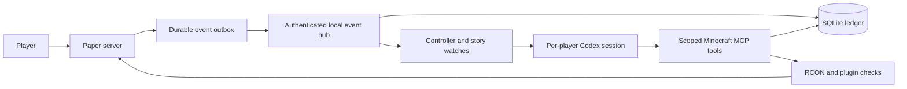

# Minecraft God

**A personal AI deity for every player in a shared Minecraft world.**

Players explore, build, bargain, and pray. Their gods remember places and promises, notice when a quest is actually completed, and act through the live server: whispering, placing signs, building landmarks, summoning creatures, or negotiating with another player's god.

The interesting part is the connection between the story and the world. A promise to bring a blaze rod home becomes a persistent condition: the right player, carrying the right item, at the right place, in the right dimension. The controller recognizes that moment without asking the player to pray again.

**Status:** experimental, locally operated software. The full game setup targets Windows and Minecraft Java Edition. The Python bridge has no runtime dependencies beyond the standard library. Start with the offline demo; use a disposable world for your first live session.

[Try the demo](#try-it-without-minecraft) · [Install the game](docs/installation.md) · [Read the architecture](docs/architecture.md) · [Contribute](CONTRIBUTING.md)

## What it does

- **One god per player.** UUID-based profiles, private speech, persistent memories, and separate model sessions.
- **Quests with observable outcomes.** Region, inventory, block, health, and other event conditions can wake a god when something meaningful happens.
- **Actions with boundaries.** The bridge checks player ownership, protected regions, command shapes, and intervention permissions before supported mutations.
- **A shared pantheon.** Gods can exchange messages, propose agreements, and request a single-use intervention from another god.
- **A record you can inspect.** Durable event delivery, SQLite history, action deduplication, readable transcripts, replay tools, and session metrics.
- **Multiplayer maps and voice.** A minimap, world map, live friend markers, shared waypoints, and proximity voice. Local speech recognition gives each god speaker and listener context. [Setup and shortcuts](docs/multiplayer.md)

These are gameplay controls, not a guarantee that a generative character will always make a good decision. The [security model](SECURITY.md) explains the trust boundaries.

## Try it without Minecraft

Download or clone this repository, open its folder, and run with Python 3.11 or newer:

```powershell
py -3 -m god_bridge.demo
```

On Linux or macOS, use `python3` instead of `py -3`.

```text
MINECRAFT GOD / OFFLINE DEMO
Synthetic replay: return a blaze rod to a remembered library.
7 events replayed; 1 other-player event ignored.
1 objective milestone detected, without a second prayer.
Status: achieved_pending_judgment
The controller recognized the goal. A live god would judge the outcome next.
Model calls: 0. Temporary replay data was removed.
```

This is a deterministic replay through the actual controller, using [a readable synthetic scenario](god_bridge/demo_scenario.json). It does not start Minecraft, use credentials, or contact a model. The live god's dialogue and judgment are deliberately outside this demo.

To test the distributable Python package:

```powershell
py -3 -m pip install .
minecraft-god-demo
minecraft-god-doctor --offline
```

## Run the live game

You need Minecraft Java Edition, Python 3.11+, and a Codex account with access to the model you select. Install the tested Codex CLI:

```powershell
npm install -g @openai/codex@0.151.0
```

Read the [Minecraft EULA](https://aka.ms/MinecraftEULA). If you accept it, run from the repository:

```powershell
.\setup-minecraft-god.ps1 -PlayerName YourName -AcceptEula
py -3 -m god_bridge.codex_runtime login
py -3 -m god_bridge.doctor
.\start-minecraft-god.ps1
```

Connect to `localhost:25565` with Minecraft **26.2**, then use `/pray <message>` to speak privately to your god. The game keeps its own Codex login and configuration in an ignored `.codex-runtime` folder. Model usage consumes your account's allowance; the default limits are two active gods and 60 decision starts per player per hour.

Setup downloads checksum-verified Paper and SpectatorCamera builds, selects Java 25+, builds the bridge with the pinned Gradle wrapper, and generates local credentials. [Installation](docs/installation.md) covers prerequisites, first launch, and upgrading an existing checkout. [Configuration](docs/configuration.md) covers models, limits, and memory.

Stop and save the game with:

```powershell
.\stop-minecraft-god.ps1
```

## How it fits together



The controller decides **when to think**. The model decides **what the god intends**. The bridge decides **which supported actions are allowed**. Paper supplies the world facts and executes the commands. [Architecture and source map](docs/architecture.md)

## Development and verification

```powershell
py -3 -m pip install ".[dev]"
.\paper-plugin\gradlew.bat -p paper-plugin build --no-daemon
py -3 -m pytest -q
py -3 -m build
py -3 scripts/check_wheel.py
```

The Java build tests retry and recovery against a real HTTP server and generates event payloads that the Python tests send through the real event endpoint. The wheel check installs into an empty environment and runs outside the source tree. The [CI workflow](.github/workflows/ci.yml) covers Windows/Linux Python tests, packaging, PowerShell checks, and the Java/Python contract.

For a local installation with an already accepted EULA, this runs a separate disposable Paper world and checks the renderer too:

```powershell
py -3 -m god_bridge.verify_server --camera
```

No model turns are started by that verification. See [verification and release evidence](docs/release-readiness.md) for what has actually been tested and what still needs human playtesting.

## Read further

| Topic | Guide |
| --- | --- |
| Install and troubleshoot | [Installation](docs/installation.md) |
| Maps, friend markers, voice and AI hearing | [Multiplayer guide](docs/multiplayer.md) |
| Model, resource, and usage settings | [Configuration](docs/configuration.md) |
| Data flow, ownership, and source map | [Architecture](docs/architecture.md) |
| Backups, restore, logs, and cleanup | [Operations](docs/operations.md) |
| Contribute a reproducible change | [Contributing](CONTRIBUTING.md) |
| Trust boundaries and private reports | [Security](SECURITY.md) |
| Versions and release procedure | [Changelog](CHANGELOG.md) · [Release guide](docs/releasing.md) |

## License and attribution

Project code is licensed under [ISC](LICENSE). Minecraft, Paper, SpectatorCamera, Codex, and the Gradle wrapper retain their own licenses and terms; see [third-party notices](THIRD_PARTY_NOTICES.md). This is an independent project, not an official Minecraft or OpenAI product.
